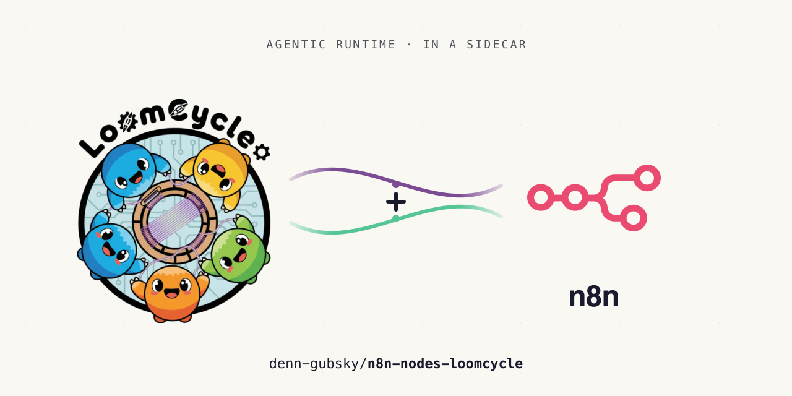

<p align="center">
  
</p>

# n8n-nodes-loomcycle

Community n8n nodes for the [loomcycle](https://github.com/denn-gubsky/loomcycle) agentic runtime — design and operate loomcycle agents directly from n8n's visual builder.

[](https://github.com/denn-gubsky/n8n-nodes-loomcycle/actions/workflows/ci.yml)
[](https://www.npmjs.com/package/@loomcycle/n8n-nodes-loomcycle)
[](LICENSE)

This package realises **Phase 2 / Vector 3** of the [loomcycle ↔ n8n integration RFC](https://github.com/denn-gubsky/loomcycle-internal/blob/main/doc-internal/rfcs/n8n-comparison.md): custom n8n nodes that let operators drive loomcycle from the n8n canvas, while loomcycle stays the agentic runtime substrate.

## 📦 Two editions — which one do I want?

This repo ships **two parallel packages** from **two branches**. Pick by where your n8n runs:

| | **Slim** (this package) | **Full** |
|---|---|---|
| npm | [`@loomcycle/n8n-nodes-loomcycle`](https://www.npmjs.com/package/@loomcycle/n8n-nodes-loomcycle) | [`@loomcycle/n8n-nodes-loomcycle-full`](https://www.npmjs.com/package/@loomcycle/n8n-nodes-loomcycle-full) |
| branch | [`main`](https://github.com/denn-gubsky/n8n-nodes-loomcycle/tree/main) | [`full-edition`](https://github.com/denn-gubsky/n8n-nodes-loomcycle/tree/full-edition) |
| nodes | **22** | **26** |
| n8n Cloud **verified** | ✅ yes — passes n8n's community-node scanner (zero deps, no langchain, no timers) | ❌ no — self-hosted only, install manually |
| AI-Agent **Tool** sub-nodes (Memory / Channel / Sub-Agent / MCP Server Tool) | — (wire the action nodes as Agent tools, or use the Chat Model) | ✅ included (langchain-based) |
| Triggers | **poll**-based (n8n schedules) | **SSE-push** + poll fallback (lower latency) |
| Run **Wait for Completion** op | — (use the Run Completed trigger / n8n Wait node) | ✅ included |
| Chat Model | `@n8n/ai-node-sdk` (langchain-free) | langchain `BaseChatModel` |

**Use the Slim package (this one)** if you're on **n8n Cloud**, want the verified node, or don't need the langchain Tool sub-nodes.

**Switch to the Full edition** if you're **self-hosted** and want the extra nodes / SSE triggers / Wait op:

```bash
# Self-hosted n8n → Settings → Community Nodes → Install:
@loomcycle/n8n-nodes-loomcycle-full
```

Both track the same loomcycle wire API and credential; they differ only in node surface + Cloud-eligibility. The rest of this README documents the **slim** package.

## Requirements

These nodes are a thin n8n-shaped wrapper over loomcycle's wire API — they **call your loomcycle deployment**, they don't run an agent runtime inside n8n. So you need:

- **A reachable loomcycle deployment + a bearer token** (loomcycle's `LOOMCYCLE_AUTH_TOKEN`). Every node call goes out to the Base URL on the **LoomCycle API** credential.
  - **Self-hosted n8n:** loomcycle can sit on `localhost` / your LAN (e.g. `http://127.0.0.1:8787`).
  - **n8n Cloud:** loomcycle must be reachable from the public internet — a public HTTPS URL or a tunnel (Cloudflare Tunnel, ngrok, …) — because n8n Cloud makes the outbound call from its own network, not yours.
- **loomcycle ≥ v0.9.2** for the substrate-admin ops (AgentDef / SkillDef / MCP Server); **≥ v0.12.x** for the Schedule node and per-tool credentials. Basic Run / Memory / Channel ops work on older builds.
- **n8n ≥ 1.82** (the package targets `n8n-workflow` ≥ 1.82).

## Quick install

```bash
# In your n8n Settings → Community Nodes → Install:
@loomcycle/n8n-nodes-loomcycle
```

Once installed, configure the **LoomCycle API** credential with your loomcycle deployment's bearer token + base URL.

The package lives under the [`@loomcycle`](https://www.npmjs.com/org/loomcycle) npm org alongside [`@loomcycle/client`](https://www.npmjs.com/package/@loomcycle/client) — same trust boundary, same maintainer.

## What's in the box

Thirty-two nodes (27 action + 4 trigger + 1 AI-Agent cluster sub-node) plus one credential type. **Zero runtime dependencies** — n8n-Cloud-verification-ready.

### Credential

- **LoomCycle API** — bearer token + base URL + optional Default User ID / User Tier / MCP URL. The credential test calls `GET /v1/_me` (whoami) to validate the bearer resolves to a principal (tenant + scopes) — requires loomcycle ≥ v0.17. Under v0.17's multi-tenant authorization (RFC L), the bearer is a tenant-scoped `OperatorTokenDef` token; provision it with the scopes your workflow's operations need.

### Action nodes

As of **2.0.0** the former single multi-resource umbrella node is split into **dedicated action nodes**, each with its own canvas icon (n8n renders one icon per node type — separate nodes are the only way to give each entity a distinct glyph). They all share one credential and one wire client; they are drag-and-drop separate in the node picker.

- **LoomCycle Run** — `Spawn` / `Spawn Batch` / `Send Input` / `Get Status` / `Get Transcript` / `Compact` / `Cancel` / `Cancel Turn` / `Replay Session` / `List Agents` / `List Runnable Agents`. Spawn-time **Sampling** / **Compaction** / **Run Timeout** overrides live under *Additional Fields*. `Spawn Batch` fans out up to 32 runs (loomcycle ≥ v0.33); `Compact` summarises a parked run's context (≥ v0.33). For **interactive runs** (loomcycle ≥ v1.1.1), enable *Additional Fields → Interactive Session* on `Spawn` — the node returns the `run_id` once the run parks at `end_turn`; steer it with `Send Input` and read final output via the **Run Completed** trigger. `Cancel Turn` stops the in-flight turn and parks the run without terminating it (RFC BH, ≥ v1.22); `Replay Session` replays a transcript into a new session on another agent (RFC BJ, ≥ v1.25); `List Runnable Agents` is the member-token-safe agent listing (RFC BY, ≥ v1.51). Spawn also accepts **image input** via *Additional Fields → Image Binary Properties* (RFC AT, ≥ v1.7) and reports token-budget crossings as a `limits[]` array (RFC AW, ≥ v1.11). (To wait for non-interactive completion, use the **Run Completed** trigger or n8n's own Wait node.)
  - **Run controls (loomcycle v1.82–v1.113)** under *Additional Fields*: per-run **Model** / **Provider** / **Tier** / **Effort** / **Max Tokens** / **Max Iterations** (each only within what the agent definition allows; anything else is refused, never dropped), **Output Schema** (the parsed answer comes back as `structured`), **Tool Choice**, **Hold for Review**, **Idempotency Key** (a retried spawn returns the first run, `deduplicated: true`), **Max Wall Time**, **Context Mode**, **Max Context Tokens**, **Hooks** (HookDef names added to this run, each under its own event) and **No Trace**.
  - **New operations:** `Get Run` (by run_id, with `result` and the settings it ran with), `List Children`, `Review` (approve, or reject with feedback to make it revise), `Retune` (change a live or parked run's settings without a turn), `Get Run Config` (its overrides, every setting with its source, or the first prompt it received), `Delete Run Tree` (needs `runs:delete`), and **drafts** — `Create Draft` / `Update Draft` / `Start Draft` / `Delete Draft`: validate a run now, start it later.
- **LoomCycle Memory** — `Get Entry` / `List Entries` / `List Scope IDs` / `List Scopes` / `Set Entry` / `Delete Entry` / `Search` / `Embed Stats` / `Reembed` / `Backfill Embeddings` / `Purge Stale Embeddings`. `Search` (RFC BV/BW, ≥ v1.47) returns one ranked list spanning k/v entries **and** document-chunk bodies, each hit tagged `fact` / `note` / `document`. The three embedding-maintenance ops are **dry-run by default** behind an explicit *Commit* toggle — `Purge Stale Embeddings` deletes. (Per-tool credentials `userCredentials` map on Spawn require loomcycle ≥ v0.12.x.)
- **LoomCycle Channel** — `Publish` / `Subscribe` / `Peek` / `Ack` / `Await` / `Broadcast` / `List Channels` / `Create Channel` / `Update Channel` / `Delete Channel` / `Purge Channel`. `Await` (fan-in) waits on a predicate across channels and `Broadcast` (fan-out) publishes to many atomically (loomcycle ≥ v0.25); yaml-declared channels remain immutable (but `Purge` is allowed on them).
- **LoomCycle Agent Definition** — `Create` / `Fork` / `Get` / `List Versions` / `Promote` / `Retire` / `Verify` (content_sha256 round-trip). Create/Fork expose a **Provider** dropdown read live from `GET /v1/config` (≥ v1.38) and folded into the overlay; it always offers the unset default plus the synthetic **Code-JS** provider, which authors a [deterministic JavaScript agent](#code-js-agents) (RFC J).
- **LoomCycle Skill Definition** — same 7 ops as AgentDef, applied to skills
- **LoomCycle MCP Server** — `Register` / `Fork` / `Promote` / `Retire` / `Get` / `List Versions` / `Rediscover` / `Verify` — dynamic MCP server registration (requires loomcycle ≥ v0.9.2)
- **LoomCycle Schedule** — `Create` / `Fork` / `Get` / `List Versions` / `Retire` — substrate-native scheduled runs (RFC E; requires loomcycle ≥ v0.12.x). Fired runs land on the **Run Completed** trigger.
- **LoomCycle Hook** — `Create` / `Fork` / `Get` / `List Names` / `List Versions` / `Promote` / `Retire` / `Verify` / `Delete` — reusable, versioned **hook definitions** (HookDef, RFC DK; requires loomcycle ≥ v1.97). A hook gates tool calls (`pre` / `post` / `post_failure`), the run itself (`agent_start` / `agent_stop` / `subagent_*` / `pre_compact`, …) or a channel's messages (`channel_publish`), with a webhook or code-js body. It fires on nothing by itself: an agent definition, a team state or a run names it. **Create** registers a new version only when the definition changed, so a re-run workflow doesn't pile up identical versions. A webhook body can be **signed** (Signing Credential, loomcycle ≥ v1.113). *loomcycle v1.97 removed the old global registration API, so the former `Register` / `List` / `Delete` operations are gone.*
- **LoomCycle Webhook** — `Create` / `Fork` / `Get` / `List Versions` / `Retire` — **inbound** webhook endpoints (RFC H; requires loomcycle ≥ v0.14.x): an external POST to a loomcycle-hosted endpoint spawns an agent run / publishes to a channel. (Distinct from **Hook** above, which is outbound.)
- **LoomCycle A2A Agent** — `Create` / `Fork` / `Get` / `List Versions` / `Retire` — register **external** A2A (Agent2Agent) agents loomcycle can call as tools (RFC G; requires loomcycle ≥ v0.14.x).
- **LoomCycle A2A Server Card** — `Create` / `Fork` / `Get` / `List Versions` / `Retire` — manage the agent card loomcycle **publishes** to expose its own agents to external A2A clients (RFC G; requires loomcycle ≥ v0.14.x).
- **LoomCycle Interruption** — `List for User` / `List for Run` / `Resolve` / `Decline` — [human-in-the-loop](#human-in-the-loop) over `Interruption.ask`: list pending agent questions and post a human's answer back to unblock the parked run. `Decline` (RFC BH P2, ≥ v1.22) refuses to answer without killing the run — the agent's Question tool returns a non-error "declined" and it continues. (Requires loomcycle's consumer-MCP interruption backend.)
- **LoomCycle LLM** — `Chat` / `Embeddings` — direct calls to loomcycle's LLM gateway (`POST /v1/_llm/*`) as a workflow step: provider routing + auth + retry handled substrate-side, no agent loop. For RAG / embedding pipelines. (Distinct from the **Chat Model** sub-node, which feeds an AI Agent.)
- **LoomCycle Memory Backend** — `Create` / `Fork` / `Get` / `List Versions` / `Retire` — versioned memory-backend definitions (in-process or external REST store + ranker) that agents' Memory tool dispatches to (RFC I; requires loomcycle ≥ v0.15).
- **LoomCycle Operator Token** — `Get` / `List` / `Retire` — operator-token lifecycle (RFC L; requires loomcycle ≥ v0.17). **Mint + rotate are intentionally NOT here** — those return the token secret, which must not enter n8n execution data; do them via the loomcycle Web UI / CLI.
- **LoomCycle Snapshot** — `Create` / `List` / `Get` / `Restore` / `Delete` / `Export URL` / `Pause Runtime` / `Resume Runtime` / `Get Runtime State` / `Resolve Probe` — runtime snapshot backup + restore (loomcycle ≥ v0.8.17): snapshot before a deploy, restore on rollback. Restore accepts a stored snapshot ID or an inline envelope; Export URL returns a bearer-authed download link. The four runtime-maintenance ops are grouped here because they are what you reach for *around* a snapshot: pause so nothing is admitted mid-capture, capture, deploy or restore, resume. Note pausing does **not** stop runs already in flight — `Get Runtime State` reports what still is.
- **LoomCycle Volume** — `Create` / `Get` / `List` / `List Ephemeral` / `Delete` / `Purge` — filesystem Volumes (RFC AH; requires loomcycle ≥ v1.1). Provision named ro/rw filesystem roots for agents (the runtime derives the on-disk path); since v1.1 a Volume is the only way an agent gets filesystem access. `Delete` unmaps but keeps the files; `Purge` removes the tree.
- **LoomCycle Path** — `Resolve` / `List` / `Stat` / `Make Directory` / `Move` / `Remove` — the Path VFS (RFC AL; requires loomcycle ≥ v1.4): a Unix-like filesystem naming Memory entries / Volume mounts / Documents by human-readable path (e.g. `/docs/launch`). Scope (agent / user / tenant) resolves server-side from the bearer.
- **LoomCycle Document** — 36 ops over the chunked-graph Document store (RFC AK + BS / BO / CE; requires loomcycle ≥ v1.4 **and SQL Memory** on the sidecar). Document + chunk lifecycle, edges and discovery (`Backlinks` / `Related` / `Unlinked Mentions`), tags, types, `Query Chunks` (structured filters, `Under Path`, or a validator-gated read-only SQL escape hatch), per-chunk `History` / `Get Version` / `Diff Revisions`, Markdown and **JSON Canvas** import-export, image assets, and peer federation (`Set Remote` / `Sync` / `Diff Remote`). A chunk body is embedded on write, which is what makes **Memory → Search** find it.
- **LoomCycle Fact** — 10 ops over the RFC CC verified-writes tier (loomcycle ≥ v1.54): `Remember` / `Upsert Fact` / `Supersede Fact` / `List Facts` / `Judge Fact` / `Verbatim Answer` / `Verification Stats` / `Graph Recall` / `Propose Entity` / `Search`. A fact stores the exact **source span** it was drawn from and a write-time judge checks the claim against it; a fact that fails is **withheld, not deleted** (pass *Include Refuted* to audit it). `judged_at` / `judged_by` are server-stamped with no wire field, so a caller cannot record a machine verdict as an operator one. Corrections go through `Supersede Fact` — `Remember` is additive only, there is no forget.
- **LoomCycle Document Source** — `Create` / `Fork` / `Get` / `List Versions` / `Retire` — register a peer loomcycle instance as a document source (RFC CE; requires loomcycle ≥ v1.54), which the Document node's `Set Remote` / `Sync` ops consume. Operator-admin only; the overlay carries `api_key_env`, the env-var **name** of the peer bearer, never a plaintext token.
- **LoomCycle Team** — `List` / `Get` / `Create` / `Fork` / `Promote` / `Retire` / `Verify` / `List Versions` / `Delete` / `Run` / `Cancel Walk` / `List Walk Runs` / `Get Breakpoints` / `Set Breakpoints` / `List Channels` / `Peek Channel` / `Release Channel` / `Render Diagram` — **Agent Teams** (RFC AP; requires loomcycle ≥ v1.17.1). A TeamDef is a versioned **state-machine graph** of agent roles: states carry a handler (`agent` / `parallel` / `consolidator` / `terminal`) and transitions are gated on each state's outcome. `Run` walks the graph, spawning an agent per state until a terminal — and bound to a **Document chunk task board** it persists `chunk.status` per transition, so progress is durable and a later Run **resumes** rather than restarting. `Render Diagram` emits Mermaid `stateDiagram-v2`, optionally highlighting the state a walk has reached. This is the closest analogue loomcycle has to an n8n workflow: n8n designs and triggers it, the substrate runs it under its own admission control.
  - **Since loomcycle v1.101–v1.113:** a walk is a run. `Run` can start it **detached** (turn off *Wait for the Walk to Finish*) and returns its `run_id`, which `Cancel Walk`, `List Walk Runs` and the breakpoint ops take. `Run` also sets the team's **Variables**, holds chosen states' answers **for review**, arms **breakpoints**, takes an **Idempotency Key**, and can **ask a human at the iteration cap**. `Create` / `Fork` have a **Promote** toggle (Create on, Fork off by default), and `Verify` checks either a deployed version against a hash or an **unsaved graph** (every problem a save would hit, each with a JSON path).
- **LoomCycle Directory** — `List Users` / `Inspect Subject` / `List Tenants` — read-only "who is in this deployment and what is held for them" (loomcycle ≥ v1.46). `Inspect` aggregates one subject's activity, chats, memory, documents, budget and usage in a single call. There is no create or update: a user here is **derived from run activity**, not stored. `List Tenants` needs an operator-admin token and refuses a tenant-scoped one outright rather than filtering.
- **LoomCycle Erasure** — `Report` / `Execute` — subject erasure (RFC BL P5; requires loomcycle ≥ v1.45, **and the deployment must set `LOOMCYCLE_AUDIT_LOG_PATH`** from v1.55). The natural home for a **GDPR data-subject-request workflow**. Three tiers: deletable, subject-keyed-but-uncovered, and residue — facts about the subject in scopes they do not own. `Execute` is a **dry run unless you commit**, and committing additionally requires retyping the subject. **Persist the Execute output**: residue is traceable only through the subject's chats, which Execute deletes, so a later report shows 0 while those facts remain — the response is the only durable record.
- **LoomCycle User** — `List` / `List Tokens` / `Revoke Token` — tenant-owned users and their delegated bearer tokens (RFC BX P2; requires ≥ v1.50). The tenant is always server-derived, so no operation takes one. **Reads plus one revocation, by design.** Identity CRUD is absent because provisioning and removing users is operator work for the loomcycle CLI / Web UI, not a workflow side effect; `Revoke Token` stays because cutting off a leaked credential is exactly what you want to automate on an alert. **Minting is absent for a stronger reason** — the substrate returns the bearer plaintext once, and it must not land in execution data.
- **LoomCycle Usage** — `Usage Report` / `List Limits` / `Get Config` — token + cost attribution (RFC AV; ≥ v1.10) and a read of the per-scope token budgets (RFC AW; ≥ v1.11). Group a report by `source` to see **which key actually paid** — operator vs tenant. **Read-only by design:** budget writes stay operator-only even for a tenant member, and `setLimit` is a full-row upsert whose omitted tier *clears* that ceiling — too easy to do damage with from a half-filled form. Set budgets via the CLI / Web UI.
- **LoomCycle History** — `List` / `Get` / `Search` / `Related` / `Rename` / `Annotate` / `Pin` / `Archive` / `Recap` / `Resume` — past chats as first-class objects (RFC BE; requires loomcycle ≥ v1.20). The owner is resolved server-side, so you pick a **scope** (self / user / tenant / global — the last admin-only) rather than naming one. `Get` renders a transcript as structured events, full Markdown, or **Conversation** (user and assistant turns only) — use the last when feeding a chat to a model, since it strips the tool traffic that is usually most of the tokens. ⚠️ **`Search` matches the chat TITLE only**, not content or summaries; **`Related`** is the semantic path and is what you want for "find the conversation about X".

> **Migration from 1.x:** the umbrella `LoomCycle` node (type `loomCycle`) was removed. Workflows built on 1.x must swap each `LoomCycle` node for the matching dedicated node (e.g. a `LoomCycle` node with Resource = Memory → **LoomCycle Memory**); operations and parameters are otherwise unchanged.

### Trigger nodes

All three triggers use n8n's **polling** framework (`poll()`), scheduled by n8n's Poll Times — no in-node timers (n8n Cloud forbids timer primitives in community nodes). Detection latency is the poll interval.
- **LoomCycle: Change Event** — the one genuinely **event-driven** trigger here (RFC CD Part C; requires loomcycle ≥ v1.54 and `LOOMCYCLE_MEMORY_CHANGES_ENABLED=1`). loomcycle POSTs HMAC-signed batches to this node's webhook URL on every memory / document write, so it needs no polling. Events are **value-free** — each carries the *coordinate* of what changed, never the value — so follow it with Memory → Get Entry or Document → Get Chunk to read the current state. Signature verification **fails closed**, and because delivery is at-least-once with a persisted cursor on the loomcycle side, the node dedupes on the monotonic `seq`. Subscriptions are operator-yaml only: add a `change_subscriptions:` entry pointing `callback_url` at the Production webhook URL.

- **LoomCycle: Review Pending** — polls for runs whose answer is **held for review** (loomcycle ≥ v1.113), so a person can rule on it with **Run → Review**. A rejected answer that comes back revised fires again.
- **LoomCycle: Run Completed** — polls for agent runs that have reached a terminal state (completed / failed / cancelled / rejected), deduping via workflow static data. Filterable by status + `parentAgentId`.
- **LoomCycle: Channel Message** — polls a channel each tick: `auto-ack` (at-most-once, `subscribeChannel` poll-once) or `peek + explicit ack` (at-least-once, cursor persisted in workflow static data).
- **LoomCycle: Interrupt Pending** — polls for new **pending interruptions** (agent questions) for a user, deduping by `interrupt_id`. Wire the output to a human channel (Slack / email / form) and feed the answer back via **LoomCycle Interruption → Resolve**.

### Cluster sub-node (plugs into n8n's AI Agent)

- **LoomCycle Chat Model** — plugs into the AI Agent's **Chat Model** slot. Routes the agent's LLM calls through loomcycle's gateway (`POST /v1/_llm/chat`) instead of a direct provider SDK. Single credential covers all providers; loomcycle's resolver picks provider / model at request time; per-user quota tracking; single audit log. Supports tool calling. Built on **`@n8n/ai-node-sdk`** (`BaseChatModel`) — langchain-free, so the package stays Cloud-verifiable. **No agent loop** — this is the thin gateway shim, not the full runtime; use the **LoomCycle Run** action node for the full loop.

> **Removed in v3.0.0:** the langchain-based Memory / Channel / Sub-Agent / MCP Server **Tool** sub-nodes. n8n Cloud bans community nodes that depend on `@langchain/core`, and `@n8n/ai-node-sdk` has no tool-supply API yet. To give an AI Agent loomcycle capabilities, wire the **action nodes** (Run / Memory / Channel) as the Agent's tools, or call loomcycle via the **Chat Model**. The Tool sub-nodes will return if/when the SDK adds a tool path.

## Configure the credential

In n8n, navigate to **Settings → Credentials → New** and pick **LoomCycle API**.

| Field | Required | Notes |
|---|---|---|
| Base URL | yes | e.g. `http://127.0.0.1:8787` |
| Bearer Token | yes | Matches loomcycle's `LOOMCYCLE_AUTH_TOKEN` env var |
| Default User ID | no | Falls through to any node where `userId` is left empty |
| Default User Tier | no | Same fall-through |
| MCP URL (optional) | no | Only needed if you reference loomcycle's MCP server from n8n's MCP Client Tool sub-node (Vector 1) |

Click **Test** → a green checkmark means the bearer authenticated. Behind the scenes: `GET /v1/_me` with `Authorization: Bearer <token>` — this resolves the token's principal (tenant + scopes), so an invalid / expired / wrong-tenant token fails the test here rather than at runtime. (Requires loomcycle ≥ v0.17; on older deployments, change is needed — see the editions/compat notes.)

## Examples

Four importable workflow JSONs in [`examples/`](examples/) cover the canonical patterns:

| # | File | Pattern |
|---|---|---|
| 01 | [`01-multi-agent-research.json`](examples/01-multi-agent-research.json) | Researcher → summariser → channel digest |
| 02 | [`02-slack-loomcycle-slack.json`](examples/02-slack-loomcycle-slack.json) | Slack trigger → loomcycle agent → Slack reply |
| 03 | [`03-daily-activity-report.json`](examples/03-daily-activity-report.json) | Cron → `listAgents` → JS aggregation → email |
| 04 | [`04-n8n-as-loomcycle-tool.json`](examples/04-n8n-as-loomcycle-tool.json) | **Vector 2** — n8n workflow as MCP server consumed by loomcycle |

*(The AI-Agent + cluster-tool examples were removed in v3.0.0 alongside the langchain Tool sub-nodes.)*

Import via **Workflows → Import from File**, then attach your LoomCycle API credential. See [`examples/README.md`](examples/README.md) for per-example prerequisites + caveats.

## Provisioning MCP servers dynamically

The **LoomCycle MCP Server** action node registers HTTP / Streamable-HTTP MCP servers in the substrate at workflow-design time (run it once, ahead of any Run nodes), so spawned agents can reference them as `mcp__<name>__*`:

1. **Register:** `mcpServerDef({op: 'create', name, transport, url, headers, promote: true})`. Re-registering identical content is a no-op (`deduplicated: true`) on loomcycle ≥ v0.20, so you can run Register unconditionally — no Get-first dance needed.
2. **Manage:** Fork / Promote / Retire / Rediscover / Verify the registration as versioned MCPServerDefs.
3. Spawn agents (via **LoomCycle Run**) with `allowed_tools: ['mcp__<name>__*']` to give them the MCP server's tool surface.

**Tool auto-discovery (loomcycle ≥ v0.20).** Register/Fork run the MCP `tools/list` handshake at registration and return a `discovered` count in the node output — you can see the tool surface immediately instead of waiting for first call. It's best-effort: an unreachable peer still registers and self-heals lazily. Untick **Discover Tools at Registration** to register connection metadata only.

**A create-time check to know about (v0.20):** the URL host is validated against the allowlist *at registration* (a loopback / RFC1918 callback host must be in the **private** host allowlist, not just the general one).

> *(Through v2.x this was an auto-provisioning AI-Agent cluster tool. That tool was langchain-based and removed in v3.0.0; the same substrate capability is now driven explicitly via the MCP Server action node.)*

### Secrets in headers: `$cred:<name>`

The Headers field takes **references**, never a secret. Store the secret once in loomcycle as a credential and reference it by name:

```
Authorization: Bearer $cred:slack-token
```

loomcycle resolves `$cred:<name>` on every call (agent > user > tenant credential), so nothing secret travels from n8n to loomcycle and nothing has to be copied into loomcycle's environment.

**`${LOOMCYCLE_*}` env references are now admin-only.** From loomcycle **v1.113** a runtime MCP server definition holding `${NAME}` is refused when an agent dials it, unless an **admin** token saved it. So with a tenant or user token, `$cred:` is the only form that works; with an admin token the old env form still works, but the env var must exist on the loomcycle host *before* you register (the discovery handshake expands it). Operators can restore the old behaviour temporarily with `LOOMCYCLE_MCP_REFUSE_UNATTRIBUTED_ENV=0`.

## Code-JS agents

[code-js](https://github.com/denn-gubsky/loomcycle) (RFC J) is a loomcycle **synthetic provider**: the agent runs deterministic JavaScript instead of an LLM — replayable, no model cost. A code-js agent is just an Agent Definition with `provider: code-js` (and no model), spawned through the normal **LoomCycle Run** → **Run Completed** lifecycle. No dedicated node is needed.

**Author it inline from n8n** (loomcycle ≥ **v0.20**): on **LoomCycle Agent Definition → Create** (or **Fork**), pick **Code-JS** in the Provider dropdown and write the source in the **JavaScript Code** editor that appears. The node folds it into the overlay as `code_body`; loomcycle compiles + content-hashes it at registration. No host filesystem access needed — the code travels the wire like any other definition field.

One host prerequisite: enable the provider with `LOOMCYCLE_CODE_AGENTS_ENABLED=1` (default off — operator-trust, same posture as the Bash tool; or registration is refused). Inline source is capped at ~256 KB. For reproducible runs, optionally `LOOMCYCLE_CODE_AGENTS_DETERMINISTIC=1`.

> **Filesystem fallback (still supported):** leave the JavaScript Code editor empty and loomcycle falls back to `agent_code/<name>/index.js` (under `LOOMCYCLE_CODE_AGENTS_ROOT`) on the host, where `<name>` matches the Agent Definition name. Inline `code_body` wins when both are present.

## Passing metadata to agents

loomcycle ≥ **v0.21** adds a **non-secret metadata channel** to the agent. A code-js agent reads it as `input.metadata`; an LLM agent receives it as a trusted prompt block. It's for context, not secrets (metadata is safe to log) — keep tokens in the credentials fields. Three entry points, all surfaced as a **Metadata (JSON)** field:

- **LoomCycle Run → Spawn** — `Metadata (JSON)` under *Additional Fields*. Per-call and trusted (first-party bearer); not inherited by a continuation.
- **LoomCycle Schedule → Create / Fork** — static `Metadata (JSON)`, delivered on every scheduled fire. Override it per fork for the canonical "one template, a different `repo` per tenant" pattern.
- **LoomCycle Webhook → Create / Fork** — two channels:
  - **Static** `Metadata (JSON)` — operator-authored, delivered **trusted**.
  - **Request-sourced** — add `payload_mapping` entries with `run_metadata.<name>` targets in the *Advanced Overlay* (e.g. `{"run_metadata.repo": "$.repository.full_name"}`). These are projected from the inbound POST body and delivered **untrusted** (fenced in a `<run_metadata>` block for LLMs, `input.payload_metadata` for code-js).

The Webhook node also gains **Per-Delivery Credentials** (template strings → `user_credentials`), reaching parity with the Schedule node's per-fire credentials.

## Human-in-the-loop

A loomcycle agent can call **`Interruption.ask`** to pause and ask a human a question (optionally with a fixed set of options). n8n is the natural place to answer it — and the **LoomCycle: Interrupt Pending** trigger + **LoomCycle Interruption** node close the loop end-to-end:

1. **Interrupt Pending trigger** fires when a new pending ask appears for a user (`listUserInterrupts`, deduped by `interrupt_id`). Each item carries `run_id`, `interrupt_id`, `question`, and any `options`.
2. **Route it to a human** — a Slack message, an email, an n8n Form, an approval step.
3. **LoomCycle Interruption → Resolve** posts the human's `answer` back (`resolveInterrupt(run_id, interrupt_id)`). The parked agent unblocks and continues. When the ask declared options, the answer must be one of them (validated server-side).

> Requires loomcycle's **consumer-MCP interruption backend** so an external resolver is accepted (set in the deployment's yaml). Without it, asks are answered through loomcycle's own Web UI / CLI instead.

### Review holds: approve an answer before it counts

The other direction: the agent has *finished*, and a person decides whether its answer stands (RFC DJ, loomcycle ≥ v1.93).

1. **Spawn** with *Additional Fields → Hold for Review* (or attach an `agent_stop` hook that answers `hold`). The run finishes its answer and is **held**; Spawn returns at once with `awaitingReview: { expiresAt, round }` and the `runId`.
2. **LoomCycle: Review Pending** fires for each held run (or carry the `runId` straight from the Spawn output).
3. **Run → Review**: *Approve* completes the run with the held answer. *Reject* with feedback sends the feedback back as its next turn, and the run revises and is held again. *Reject* without feedback ends it as `rejected`, which the **Run Completed** trigger can catch.

A hold nobody rules on before `expiresAt` ends the run as `rejected` (`review_expired`) — an unreviewed answer is never approved by default. *Review Time Limit* sets the window.

## Local development install

Want to install from the local checkout for development?

```bash
# In this package:
git clone https://github.com/denn-gubsky/n8n-nodes-loomcycle.git
cd n8n-nodes-loomcycle
npm install
npm run build
npm link

# In your n8n install (e.g. ~/.n8n/nodes):
cd ~/.n8n/nodes
npm link @loomcycle/n8n-nodes-loomcycle

# Then restart n8n. The 20 nodes appear under the "LoomCycle" prefix in
# the node picker.
```

## Compatibility

### Loomcycle version compatibility

| Feature | Min loomcycle | Notes |
|---|---|---|
| Run / Memory (read) / basic Channel | v0.8.x | Substrate stability since v0.8.4 |
| Channel CRUD (publish / subscribe / peek / ack) | **v0.9.2** | PR #180 on the substrate |
| AgentDef + SkillDef substrate-admin ops | v0.8.22 | PR #163 |
| `content_sha256` Verify op | v0.9.x | PR #175 |
| **MCPServerDef substrate** (dynamic MCP) | **v0.9.2** | PR #177; required by the **MCP Server** action node |
| `parentAgentId` filter | v0.9.2 | used by the Run Completed trigger |
| **LLM Gateway (`POST /v1/_llm/chat`)** powering `LoomCycle Chat Model` | **v0.10.x** | enables n8n AI Agent's Chat Model slot to route through loomcycle |
| Per-tool credentials (RFC F) + Schedule (RFC E) | **v0.12.x** | Schedule action node |
| Inbound Webhooks (RFC H) + A2A (RFC G) | **v0.14.x** | Webhook + A2A Agent / A2A Server Card action nodes |
| **Interactive run steering** (RFC AI) — `Run → Send Input` + Spawn's *Interactive Session* | **v1.1.1** | push operator turns into a run parked at `end_turn` |
| **Filesystem Volumes** (RFC AH) — Volume node | **v1.1** | named ro/rw filesystem roots; the only way an agent gets filesystem access since v1.1 |
| **Path VFS** (RFC AL) — Path node | **v1.4** | name Memory / Volumes / Documents by human-readable path |
| **Image / vision input** (RFC AT) | **v1.7** | Run → Spawn → Image Binary Properties; base64 only, no URL form |
| Per-scope token budgets (RFC AW) | **v1.11** | `limits[]` on the Spawn result |
| **Turn-scoped cancel + decline** (RFC BH) | **v1.22** | Run → Cancel Turn; Interruption → Decline |
| Session replay (RFC BJ P4) | **v1.25** | Run → Replay Session |
| Live provider cascade (`GET /v1/config`) | **v1.38** | Agent Definition Provider dropdown |
| Embedding maintenance | **v1.46** | Memory → Backfill / Purge Stale Embeddings |
| **Unified memory search** (RFC BV/BW) | **v1.47** | Memory → Search / Embed Stats / Reembed |
| **Agent Teams** (RFC AP) — Team node | **v1.17.1** | state-machine graphs of agent roles; board-bound runs resume |
| Usage + cost attribution (RFC AV) | **v1.10** | Usage → Usage Report |
| Per-scope token budgets (RFC AW) — read | **v1.11** | Usage → List Limits; `limits[]` on a Run result |
| **Subject erasure** (RFC BL P5) — Erasure node | **v1.45** | also needs `LOOMCYCLE_AUDIT_LOG_PATH` from v1.55 |
| Directory (derived users / tenants) | **v1.46** | Directory node; List Tenants is admin-only |
| **Delegated users + tokens** (RFC BX) — User node | **v1.50** | needs a persistent store (503 otherwise) |
| **Chat history** (RFC BE) — History node | **v1.20** | Search is title-only; Related is the semantic path |
| **Memory / document change feed** (RFC CD Part C) — Change Event trigger | **v1.54** | also needs `LOOMCYCLE_MEMORY_CHANGES_ENABLED=1` + a `change_subscriptions:` yaml entry |
| Runnable-agent discovery (RFC BY) | **v1.51** | Run → List Runnable Agents; agent dropdown fallback |
| **Chunked-graph Documents** (RFC AK) off-run | **v1.4** | Document node — **also needs `LOOMCYCLE_SQLMEM_ENABLED=1`** |
| Document tags / links / history / canvas (RFC BS) | **v1.46** | Document → Add Tags / Backlinks / History / Export Canvas |
| Document image assets (RFC BO) | **v1.30** | Document → Set Asset / Get Asset |
| **Verified writes / fact tier** (RFC CC) | **v1.54** | Fact node — source spans, verdicts, Verbatim Answer |
| **Remote document sources** (RFC CE) | **v1.54** | Document Source node; Document → Set Remote / Sync / Diff Remote |
| Memory Backend (RFC I) | **v0.15** | Memory Backend action node |
| Interruption (human-in-the-loop) | **v0.8.16** | Interruption node + Interrupt Pending trigger; resolve needs the consumer-MCP backend |
| Snapshot backup / restore | **v0.8.17** | Snapshot action node |
| Operator Token (RFC L multi-tenant auth) | **v0.17** | Operator Token node (get/list/retire); `/v1/_me` credential test |
| Inline code-js `code_body` + MCP tool auto-discovery | **v0.20** | Agent Definition JS editor; MCP Server discover toggle |
| Non-secret metadata channel | **v0.21** | Metadata (JSON) on Run / Schedule / Webhook |
| Channel fan-in / fan-out (RFC S) | **v0.25** | Channel Await / Broadcast |
| Per-run sampling override | **v0.28** | Run → Spawn → Sampling (JSON) |
| Per-run / mid-run compaction | **v0.32** | Run → Spawn → Compaction (JSON); Run → Compact |
| Batch spawn (RFC Y) | **v0.33** | Run → Spawn Batch |
| Review holds (RFC DJ) — `rejected` status | **v1.93** | Run Completed trigger's *Rejected* status; Spawn reports `awaitingReview` |
| **Hook definitions** (HookDef, RFC DK) | **v1.97** | Hook node. The old `Register` / `List` / `Delete` API was removed upstream in v1.97 |
| Idempotent spawns (`deduplicated`) | **v1.106** | Spawn reports `deduplicated: true` |
| Signed hook deliveries · scope-naming 403s · `$cred:`-only MCP headers for non-admins | **v1.113** | Hook → Signing Credential; errors name the missing scope |
| Per-run model / limits overrides, Retune, Get Run Config | **v1.82** | Run → Spawn fields, Retune, Get Run Config |
| Drafts (configured runs), output schema, tool choice | **v1.92 – v1.93** | Run → Create / Update / Start / Delete Draft; Output Schema; Tool Choice |
| Idempotency key, max wall time | **v1.106** | Run → Spawn |
| Run-tree delete, child-run listing, No Trace | **v1.111 – v1.112** | Run → Delete Run Tree, List Children; Spawn → No Trace |
| Review Pending trigger (`awaited_state` filter), model dropdown | **v1.113** | LoomCycle: Review Pending; Spawn → Model |
| Team walk is a run (detach, cancel, walk runs, breakpoints) · team variables · team channels | **v1.89 – v1.111** | Team → Run options, Cancel Walk, List Walk Runs, Get / Set Breakpoints, List / Peek / Release Channel |
| Team Promote / Retire / Verify (incl. unsaved graph), fork-with-promote, ask at cap | **v1.113** | Team node |

If you're on older loomcycle, the unaffected nodes still work; the gated ones surface a clean `NodeApiError("Requires loomcycle vX.Y")`.

### n8n version compatibility

- **Minimum:** n8n `1.82.0` (cluster-node API stability threshold)
- **Tested against:** n8n `2.22.1` (self-hosted Docker)
- **Tools Agent path:** requires n8n v1.82+ (cluster sub-nodes ship both `supplyData()` and `execute()` so they work across older modes too)
- **Node.js:** ≥ 20.15

### `@loomcycle/client` (bundled, not a runtime dependency)

`@loomcycle/client` (`^1.113.0`) is **bundled into the published nodes at build time** (esbuild), so the package ships with **zero runtime dependencies** — the requirement for n8n Cloud verification. It's a devDependency here, not a peer/runtime dep. The adapter tracks loomcycle's minor version; consuming a new wire method bumps the bundled version. `n8n-workflow` is the only peer; `@n8n/ai-node-sdk` (used by the Chat Model) is provided by the n8n host at runtime.

### Which credential do I need?

Most nodes work with any bearer, but the scope matters for some:

- **Operator-admin** — Directory → List Tenants, cross-tenant focus anywhere, Operator Token, Memory Backend, Document Source, A2A, Webhook.
- **Operator / tenant** — the substrate def plane (AgentDef, SkillDef, MCP Server, Schedule, Team), Snapshot and its runtime ops, Erasure, User.
- **A plain tenant member is enough for more than it used to be.** Since loomcycle **v1.53.2 (RFC CB)** a non-isolated `runs:*` / `channel:*` user token reaches the tenant's **Library, Documents and Memory over HTTP** with no new scope and no re-mint — which is what makes the Document, Fact and Memory nodes usable from a delegated per-user credential. Two caveats: an **isolated** token is still confined to its own user scope, and the carve-out is **HTTP-only**, so gRPC / MCP parity is deferred upstream.

### Known upstream gaps

Some substrate operations have no `@loomcycle/client` method yet, so no node can expose them — this package never hand-rolls a wire call (see [CLAUDE.md](CLAUDE.md) "Adapter conformance"). The ones you are most likely to notice:

- **Team `render_diagram` overlay preview and `format`.** The substrate can syntax-check an *unsaved* graph and render it without persisting, and emit d2 as well as Mermaid; the adapter's wrapper takes neither.
- **`credentialDef` and `evaluation`** exist as MCP meta-tools with no adapter method at all.

### Verified deployments

The integration has been smoke-tested end-to-end against the following configuration:

| Surface | What was validated |
|---|---|
| **Action node — `Run → Spawn`** | Picks an agent from the library dropdown (yaml-static + dynamic AgentDef entries, source-tagged), spawns via `runStreaming`, drains the final text + usage + stopReason into the workflow output |
| **Action node — `Channel → List`** | Lists declared channels (read-only credential smoke test) |
| **Trigger — `Run Completed` (polling)** | Workflow active → n8n calls `poll()` on the Poll Times schedule. **Correction (v4.0.0):** the v3.x poll asked for runs without a status filter, which loomcycle answers with *running* runs only, so terminal runs never emitted. v4.0.0 asks for each terminal status by name; verified against a local loomcycle v1.113, not yet in a live n8n |
| **Cluster sub-node — `Chat Model` inside n8n AI Agent** | LoomCycle Chat Model wired to the AI Agent's Chat Model slot; the agent's LLM calls route through loomcycle's gateway (provider routing + per-user quota + single audit log) |
| **Network path** | TrueNAS-hosted n8n Docker → direct IP to loomcycle (Tailscale MagicDNS bypassed) → sub-second round-trips |

> **v3.0.0 note:** triggers moved from SSE-push to n8n's polling framework (n8n Cloud bans in-node timers), so detection latency is the configured poll interval rather than near-instant.

## Troubleshooting

### `Authentication failed` after credential test

The bearer doesn't resolve to a valid principal. Verify with `curl` against the same endpoint the credential test uses:

```bash
curl -H "Authorization: Bearer <your-token>" http://127.0.0.1:8787/v1/_me
```

Expect a principal JSON (`{"tenant_id":"…","subject":"…","scopes":[…],…}`). A `401` means the token is invalid/expired; a `404` means the deployment is older than v0.17 (no `/v1/_me`). Under v0.17 multi-tenant auth, also check the token has the **scopes** for the operations your workflow calls — a missing scope surfaces as a `403` at runtime even though the credential test (which only needs an authenticated principal) passes.

### `Channel not declared` on a Publish

The channel must exist in loomcycle's `channels:` yaml block before the publish lands. Declare it operator-side and restart loomcycle. (Dynamic channel creation isn't supported in the substrate today.)

### MCPServerDef ops return "endpoint unknown"

You're on a loomcycle older than v0.9.2 (PR #177). Upgrade the substrate.

### Run Completed / Channel Message trigger isn't firing

Both are **polling** triggers — they only fire when the workflow is **Active** (production), on the schedule set by the node's **Poll Times**. In the editor, use *Fetch Test Event* to run one `poll()` manually. Detection latency is the poll interval (there's no SSE push as of v3.0.0).

Before v4.0.0, **Run Completed never fired**: it listed runs without a status filter, and loomcycle answers that with *running* runs only. Upgrade the package.

### An agent can't reach an MCP server whose headers use `${LOOMCYCLE_*}`

From loomcycle v1.113 an env reference in a runtime MCP server definition is refused unless an admin saved it. Store the secret as a loomcycle credential and change the header to `$cred:<name>` (see [Secrets in headers](#secrets-in-headers-credname)), then register again.

### The Hook node's `Register` operation is gone

loomcycle v1.97 removed global hook registration (`POST /v1/hooks`) and dropped its table, so hooks registered that way stopped firing on upgrade. Define the hook with **Hook → Create** instead, then name it where it should apply: in an agent definition's `hooks:` (or a `tools[]` entry), on a team state, or on a single run.

### `LoomCycle Chat Model` doesn't appear in n8n's AI Agent picker

n8n's cluster-node API stabilised at `1.82.0`. Older n8n versions won't show the Chat Model sub-node. Upgrade n8n.

## Filing issues / contributing

- **Bug reports:** [GitHub issues](https://github.com/denn-gubsky/n8n-nodes-loomcycle/issues) — please include n8n version, loomcycle version, and a minimum reproduction (a workflow JSON you can attach).
- **Loomcycle wire-API gaps:** file against [loomcycle](https://github.com/denn-gubsky/loomcycle/issues) — this package is a thin adapter over `@loomcycle/client`.
- **Pull requests:** see [`CLAUDE.md`](CLAUDE.md) for development conventions + the 8 locked design constraints.

## License

MIT. See [`LICENSE`](LICENSE).
